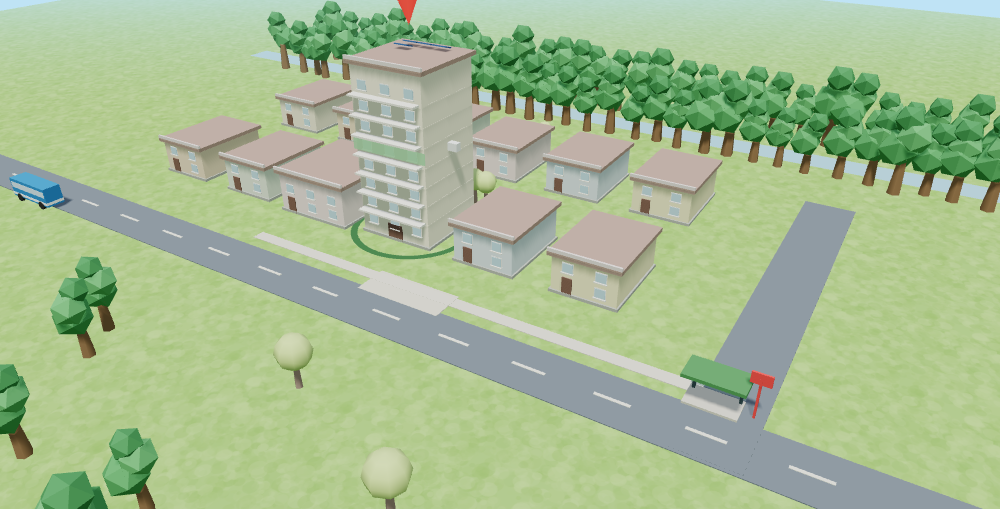
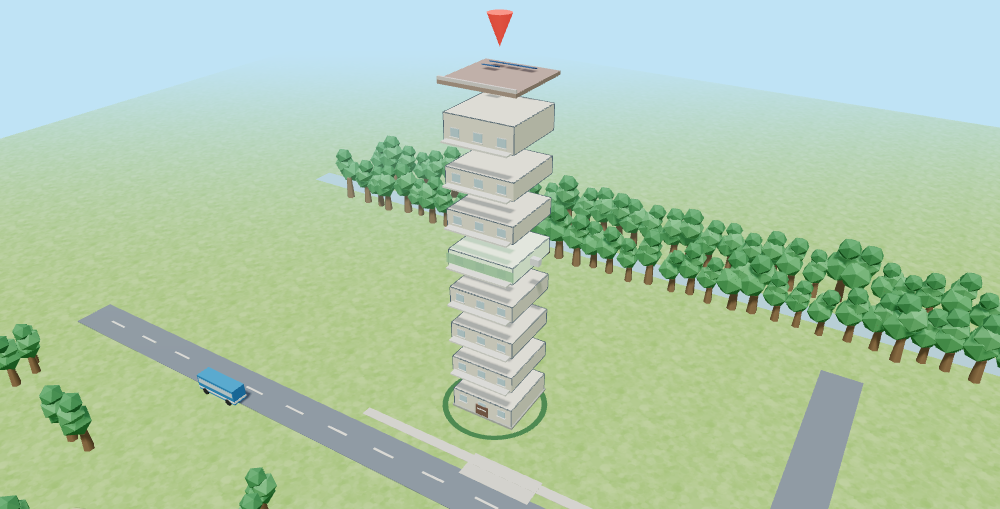

# Terrarium

**What will living here cost me?** A buyer signs for a home without knowing. The electricity bill, the daily trips and how the house copes with a hot week are all discovered after handover. Today the price and the layout are the only things a buyer can see.

Terrarium lets a buyer live **one simulated month** in an Elmina home first, and scores it on Sime Darby Property's four sustainability pillars: **Energy Low Carbon, Climate Resilience, Community Experience, Urban Biodiversity.** Built by team **SelfDev** for the Sime Darby Property University Hackathon 2026, *Township of Tomorrow*.

**Try it: https://ponli550.github.io/SDP-Terrarium/** (a static page; your home and sign-in stay in your browser)

A preview of what is merged but not yet released: https://ponli550.github.io/SDP-Terrarium/dev/



## Status, plainly

- **A working prototype**, runs in the browser, no server, no accounts that leave your machine.
- **We have not yet spoken to a buyer.** That conversation is the first next step. Nothing here shows that buyers want this or that it changes behaviour.
- **Almost every number is a placeholder.** Each figure on screen is graded, and the grade is shown next to it:

| Grade | Meaning | What is in it today |
|---|---|---|
| REAL | Public data, cited | The 0.93 km distance to the nearest public transit stop and the 5.4 km distance to rail (data.gov.my GTFS feeds; approximate centre, straight line), and the 1,450 trees planted along a 500 m stretch of the Elmina corridor (SDP's 2024 sustainability highlights slide). After handover, the electricity figure becomes REAL once an owner types the kWh from their bill. |
| SOURCED | An assumption with a published source | The nudge ceiling of about 2% (Allcott 2011, roughly 600,000 US households) |
| ILLUSTRATIVE | Our placeholder, to be replaced | Tariff, carbon factor, air-con and shade maths, scoring formulas, condo-floor effects, the drawn 12-lot layout, everything that moves |

Only REAL and SOURCED figures are headlined in the pitch. We have not measured any effect of the tool.

## What you can do

1. **Log in** (email only, a demo that keeps your home in your browser; or try it as a guest), with **Log out** always one tap away, **set your home**, and place your lot on the township map. A condo is a unit on one of eight floors.
2. **See your first look**: a checked summary of what a month in this home costs, with one next action.
3. **Compare** another home type, floor or lot side by side.
4. **Play the month**: each week set air-con, setpoint and walking, and watch the township run (windows light at night, the air-con glows on your home). A timeline under the scene lets you drag to any hour of the month, and the figures in the corner follow.
5. **Switch to Studio** to see your home alone on a turntable (tap it, or press Cross-section, to slice it open: the floors, the lift, your unit, and notes drawn from the model's own condo values), or **Exploded** to pull your home apart floor by floor and see which one is yours, over the ground beneath it (topsoil, subsoil, rock, groundwater). The ground layers are a drawing: the model has no soil or water, and the screen says so.
6. **Open Analysis** for the scores against a neighbour, the month chart, every figure with its grade, and **what to change** for the biggest cut.
7. **After handover**, type the kWh from your real bill and the model matches itself to it.



## The assistant never gets to make up a number

Questions are answered by fixed-template sentences in which **every figure is bound to a claim**. A verifier recomputes each claim from the model, and any sentence that fails is withheld. The planner is rule-based, not an LLM. The one write tool only *proposes* a change; you apply it.

## Use it from your own AI assistant (MCP)

Terrarium also runs as a local, read-only [MCP](https://modelcontextprotocol.io) server with 8 tools, every answer passing through the same verifier. On the Analysis page, the **Connect an AI assistant** card downloads your home and writes the exact config for WorkBuddy, Claude Code or Claude Desktop. Details, and what a first real session showed: [docs/MCP.md](docs/MCP.md).

## Run it

```bash
# the app: no build step
open site/index.html            # or double-click it; needs a browser with WebGL for the 3D view

# tests
npm install
npm test                        # model, assistant, profile and MCP tests, plus page checks in jsdom
npm run test:browser            # real-Chrome checks, about 10 minutes (needs Google Chrome; set CHROME to its path)
```

Without WebGL the page says so and the model, game and scores still work. The page is built to work on a phone: the real-browser suite loads every page at 360, 390, 430 and 768 px wide and fails if anything scrolls sideways, lies on top of another control, or has a tap target under 36 px (`tools/phone.html` frames the page at an exact width, because headless Chrome will not open a window narrower than 500 px).

## How it is built

Vanilla JavaScript (UMD modules, no framework), three.js r128 vendored in `site/vendor/`, Node's built-in test runner, jsdom, and headless Chrome for the 3D checks.

| Path | What |
|---|---|
| `site/logic.js` | The model, scoring, calibration to a real bill, the game, lots and condo levels |
| `site/assistant.js` | The assistant: tools, claims, and the verifier |
| `site/scene.js` | The 3D township, picking, camera, views |
| `site/app.js`, `site/index.html` | The two pages (Map and Analysis) and their wiring |
| `site/profile.js`, `site/mcpconfig.js` | Sign-in storage, the home file format, and MCP client config generation |
| `mcp/` | The MCP server and its config printer |
| `docs/` | [Criteria map](docs/CRITERIA.md), [pitch](docs/PITCH.md), [pilot proposal](docs/PILOT.md), [MCP guide](docs/MCP.md), slides |
| `tests/`, `tools/` | Unit and MCP tests; page and real-browser checks |

Tests are run with mutation checks as a habit: break the code on purpose and confirm a test fails. Several tests were tightened because a deliberate break survived.

## What we have, what we do not

**Checked:** the 0.93 km distance, what SDP's own app covers (billing, documents, defects, a virtual tour; nothing on running cost, in an undated source), the roughly 2% nudge ceiling, and the model's behaviour in tests.

**Not checked:** that buyers want this, that it changes any behaviour, the tariff and carbon figures, whether managers would use it, and how SDP's Scope 1 and 2 target maps to a resident's side (we make one home's side visible; we have not confirmed that mapping).

**Test-mode note:** headless Chrome intermittently stops delivering animation frames to a mostly static page and can hang after dumping the page. In screenshot mode only, the scene is driven from a timer, and `tools/chrome_dump.cjs` ends Chrome as soon as the page is complete. The real-browser suite (93 checks, about ten minutes) passes on the machine it was developed on; it has not been run elsewhere.

## Pilot

A proposed eight-week pilot on one Elmina phase measures uptake and model error. It **cannot show savings**: a 2% nudge is far below the month-to-month swing in a few dozen bills. Cost, partners and consent wording are not agreed with anyone. See [docs/PILOT.md](docs/PILOT.md).

## Sources

data.gov.my GTFS static feeds (Prasarana, KTMB) and the Elmina centre from OpenStreetMap · Sime Darby Property app listing and EdgeProp launch article · SDP Sustainability Strategy 2025–2030 and 2024 sustainability highlights slides · Allcott (2011), *Social norms and energy conservation*, Journal of Public Economics 95 · J-PAL, Opower home energy report evaluations.

## Licence

MIT. See [LICENSE](LICENSE).
